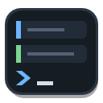
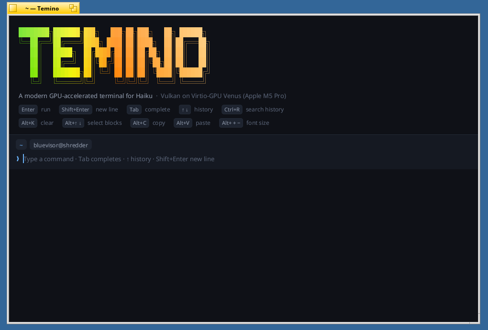
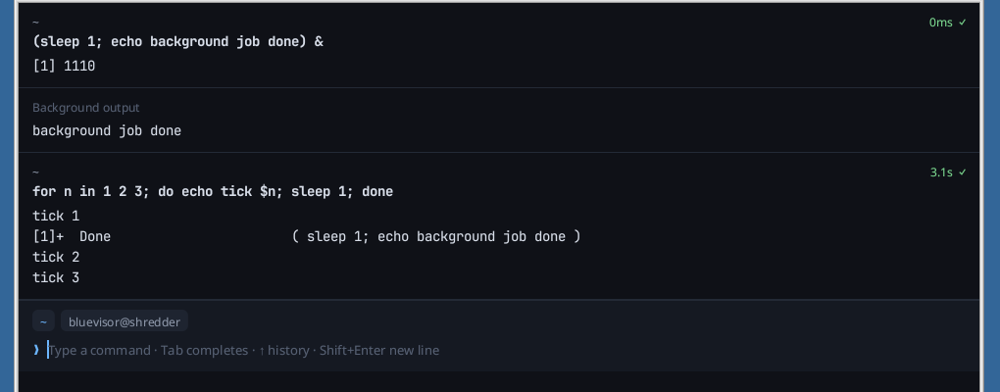

# Temino



An ADHD-friendly, GPU-accelerated terminal for [Haiku](https://www.haiku-os.org), Linux and macOS, drawn with Vulkan (Metal on macOS).

Temino works like [Warp](https://github.com/warpdotdev/warp): every command and
its output is a **block** you can select and copy, and commands are typed in a
real **editor** at the bottom of the window instead of the shell's line editor.
Full-screen programs (`less`, `vim`, `top`) get the whole window. On the
Haiku arm64 VM in UTM it renders on the Mac's GPU, through the Venus Vulkan
stack from [haiku-arm64-chromium](https://github.com/bluevisor/haiku-arm64-chromium/tree/main/gpu).





## What it does

- **Blocks.** Each command gets its own terminal grid, so output never mixes
  with prompts. A block's header shows where it ran (directory and git
  branch), how long it took and how it ended. Failed commands are marked red.
  Output that arrives while the prompt is idle (background jobs) gets its own
  block.
- **An editor for commands.** Syntax colors (known commands green, unknown
  red, flags, strings, variables), multi-line input (Shift+Enter), undo,
  word motions, selection, and fish-style **autosuggestions** from history.
- **AI mode.** Tab on an empty line switches the editor to plain words. Describe
  something to do ("rename example.jpg to example_backup.jpg") and the command
  lands in the editor to check before Enter runs it; ask a question and the
  answer shows in a block. It uses the model server in `llm_url`; with a
  [TypeSafe](https://typesafe.ai) key (`typesafe_key` in the settings file, or
  `TYPESAFE_API_KEY`) Jev decides command or answer first, from the request alone.
- **Completion and history.** Tab completes commands and paths in a menu;
  Ctrl+R searches history; Up/Down walks it.
- **A real terminal underneath.** The grid is
  [alacritty_terminal](https://crates.io/crates/alacritty_terminal): 256 and
  true colors, the alternate screen, mouse reporting, bracketed paste, OSC 52
  copy (not paste), and color and size queries.
- **Tabs and splits.** Each tab holds a tree of panes split side by side or
  stacked; drag a divider to resize, zoom one pane to fill the tab, and new
  panes start in the current pane's directory. Tabs are listed down the left
  side once there is a second one, or across the top (Settings, or
  `TEMINO_TABS=top`).
- **Settings in a tab.** Cmd+, opens them: background color, text size,
  default shell, tab list position and updates; on macOS also how
  see-through the background is and whether the desktop behind it is
  blurred. On macOS frames render straight into the window's Metal layer.
- **GPU text.** Glyphs come from a 2048² atlas (fontdue) and are drawn as
  instanced quads; rounded rectangles, borders and shadows are a signed
  distance field shader. Box-drawing and block characters are drawn
  procedurally so they join across cells.

## Keys

**Cmd** below is the shortcut modifier: Alt on Haiku (its Command key), ⌘ on
macOS, Ctrl+Shift (or Super) on Linux.

| Key | |
|---|---|
| Enter / Shift+Enter | run / new line |
| Tab on an empty line | switch between the shell and AI mode |
| Tab, Ctrl+Shift+Space, Ctrl+R, ↑ ↓ | complete, list every command, search history, browse history |
| → or End at the end of the line | accept the suggestion (Ctrl+→ one word) |
| Cmd+T | new tab |
| Cmd+D / Cmd+E | split the pane right / down |
| Cmd+W, Cmd+Q | close the pane (its tab with its last pane), quit |
| Cmd+[ / Cmd+], Cmd+Option+arrows | previous / next pane, the pane in that direction |
| Cmd+\` / Cmd+Shift+\` | the agent waiting on you longest / most recently; with none, the pane you were in before |
| Cmd+Enter | zoom the pane to the whole tab, and back |
| Cmd+1…8, Cmd+9 | a tab, the last tab |
| Cmd+B | hide / show the tab list |
| Ctrl+PageUp / PageDown, Ctrl+Tab / Ctrl+Shift+Tab | previous / next tab (on Haiku Ctrl+Tab stays the window switcher) |
| Cmd+C, Cmd+Shift+C, Cmd+V | copy (selection, else the selected block's output), copy the block's command, paste |
| Cmd+↑ / Cmd+↓ | select the previous / next block |
| Cmd+K, Ctrl+L | clear the blocks |
| Cmd+= / Cmd+- / Cmd+0 | font size |
| Ctrl+C | interrupt the running program (at the prompt: clear the line) |
| Shift+PageUp / PageDown | scroll while a program runs |

Click a block to select it; drag over output to select text (double-click:
word, triple: line). Click a pane to focus it; middle-click a tab to close it.
On Linux a selection also goes to the primary selection, and middle-click
pastes it. Option (macOS) and Alt (Linux) are Meta for the shell.

## How it works

```
 BWindow / BView  ──events──▶  core thread  ◀──bytes──  pty reader ◀── bash
 (src/haiku/shim.cpp)          (src/app.rs)                 │
        ▲                          │                        │ OSC 133 / 7 markers
        │ BBitmap copy             ▼                        ▼
        └──────────────  Vulkan offscreen frame  ◀──  blocks (one alacritty Term each)
                         (src/gpu.rs, Venus)            (src/session.rs)
```

- **Shell integration.** bash starts with `--rcfile` pointing at
  [`src/shell/temino.bash`](src/shell/temino.bash). It sources the usual login
  files, then reduces the prompt to invisible OSC 133 markers (prompt start,
  prompt end, output start, done with exit status), OSC 7 for the working
  directory and OSC 6973 for PS2 continuations. Temino pulls these out of the
  byte stream and routes the bytes in between: output goes to the running
  block's grid, and the shell's echo of the command is dropped.
- **Sending commands.** Haiku's tty line discipline caps a canonical line at
  255 bytes (`MAX_CANON`), so commands go through readline in raw mode, bound
  so that Tab characters stay text.
- **Rendering.** Haiku has no Vulkan window-system integration, so each frame
  renders into an offscreen `B8G8R8A8` image, is copied into a host-visible
  buffer and handed to the window thread, which copies it into one of two
  `BBitmap`s and draws it. Linux and macOS use the same path, with a
  [winit](https://github.com/rust-windowing/winit) window and
  [softbuffer](https://github.com/rust-windowing/softbuffer) in place of the
  Be API (`src/platform/`); macOS draws the same scene through Metal
  (`src/metal.rs`, `src/macos/shim.m`) instead of Vulkan. On HiDPI screens the scene is drawn at the
  display's scale, glyphs rasterized at full resolution. Frames are drawn only when something changed (or a
  spinner or the caret blinks); a 980×640 frame takes about 1 ms on an M5 Pro
  through Venus.
- **No fork() on Haiku.** The shell is started with `load_image()`, through a
  `temino --pty-exec` helper that makes the session and controlling tty and
  then execs bash. On this Haiku build, fork() makes the parent's Venus memory
  mappings copy-on-write, which stalls the Venus command ring (Venus aborts)
  and hung the VM when the process exited. See the
  [driver note](https://github.com/bluevisor/haiku-arm64-chromium/blob/main/gpu/README.md).
  Linux and macOS start it the usual way, `openpty` and fork/exec.

## Building

### Linux and macOS

Rust, plus a Vulkan driver on Linux: Mesa or NVIDIA (tested on a Jetson AGX
Orin, Ubuntu 22.04, X11). macOS renders with Metal and needs only the Xcode
command-line tools; `macos/bundle.sh install` builds Temino.app and copies it
to /Applications.

```sh
cargo build --release
target/release/temino --selftest /tmp/frame.ppm
target/release/temino
```

Settings live in `~/.config/temino` on Linux and `~/Library/Application
Support/Temino` on macOS. On macOS Temino prefers Homebrew's bash; the
system's bash 3.2 also works (the integration marks command output with a
DEBUG trap there, since PS0 needs bash 4.4).

### Haiku

On Haiku (tested on arm64, hrev60290) with Rust, a C++ compiler and a Vulkan driver
(`libvulkan.so.1` on the library path):

```sh
cargo build --release
target/release/temino --selftest /tmp/frame.ppm   # one offscreen frame, no window
target/release/temino
haiku/package.sh                                 # dist/temino-<version>-1-<arch>.hpkg
cp dist/temino-*.hpkg ~/config/packages/          # adds Temino to Deskbar
```

From a Mac, `haiku/deploy.sh` copies the tree to the VM (`HOST`, default
`haiku-dbg`), builds it there and starts it. For Intel Haiku, `haiku/cross.sh x86_64`
and `haiku/cross.sh x86` cross-compile in Docker (Haiku's R1/beta5 cross-compiler
image plus Rust nightly with `-Zbuild-std`, since the Haiku targets are tier 3) and
package on the VM: `dist/temino-<version>-1-x86_64.hpkg`, and
`dist/temino-<version>-1-x86_gcc2.hpkg` for 32-bit Haiku (built for its gcc 13 `x86`
secondary architecture). The Intel packages depend on the Vulkan loader and Mesa's
lavapipe software driver (`vulkan` + `mesa_lavapipe`, or `vulkan_x86` +
`mesa_x86_lavapipe` on 32-bit), since Haiku's repositories have no GPU Vulkan driver;
install them with `pkgman install temino-*.hpkg` so the dependencies come along.
Both were tested on R1/beta6 in QEMU. `haiku/keysend.cpp` posts key
presses to a window for scripted tests. After editing a shader, run
`shaders/build.sh` (needs `glslc`).

Set `TEMINO_TRACE=1` to log startup and frame stages to `trace.log` in the
settings directory (`~/config/settings/Temino` on Haiku). History, the shell
integration script and crash logs live in the same directory. `TEMINO_SHELL` picks another bash.
`TEMINO_CAPTURE=frame.ppm` saves every frame as it's drawn, for screenshots.

## Updates

Temino checks GitHub for a newer release once a day at launch, and from
Temino ▸ Check for Updates (Cmd+U). It downloads the build for your system and
swaps it in; the new version runs from the next launch. It replaces
Temino.app on macOS and the `temino` binary on Linux. On Haiku it replaces the
package in `~/config/packages` when you quit, because swapping the package
stops a running Temino. To turn off the daily check, switch it off in
Settings (or put `updates=off` in the `settings` file). Updates need `curl`.

## Credits

- The rounded-rectangle and shadow shader math follows `rect_shader.wgsl`
  from Warp's UI framework (`warpui`, MIT).
- [alacritty_terminal](https://github.com/alacritty/alacritty) (Apache-2.0),
  [fontdue](https://github.com/mooman219/fontdue), [ash](https://github.com/ash-rs/ash),
  and on Linux and macOS winit, softbuffer and
  [arboard](https://github.com/1Password/arboard).
- [JetBrains Mono](https://www.jetbrains.com/lp/mono/) and
  [Noto Emoji](https://fonts.google.com/noto/specimen/Noto+Emoji) (SIL OFL 1.1), bundled;
  UI text uses the system's Noto Sans (Haiku), Ubuntu or DejaVu Sans (Linux)
  or Arial (macOS).

Temino is MIT licensed.
